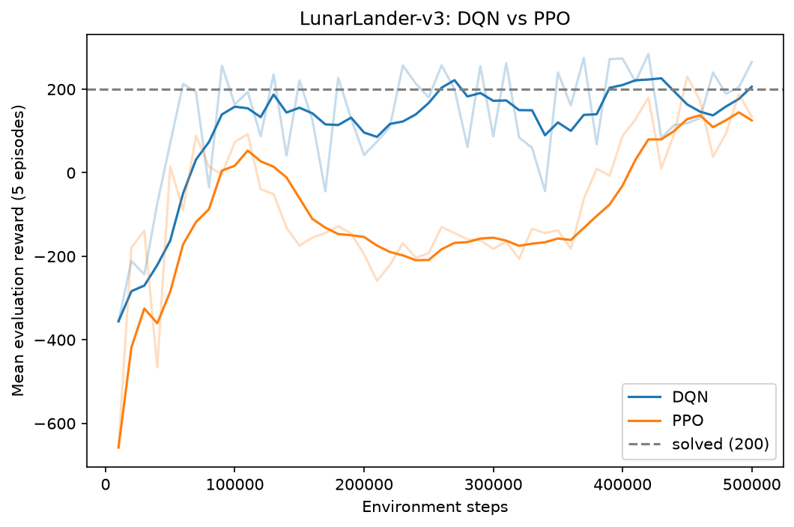

# lunarlander-dqn-vs-ppo

DQN and PPO trained on LunarLander-v3 with Stable-Baselines3, compared at the same step budget and seed, with a Gradio app showing the results and one rollout video per agent.

This repo is my submission for this week's deliverable for the Flexisaf internship. The brief: build two working models that demonstrate advanced deep learning and reinforcement learning, each in its own repo with a Gradio demo and a screen recording. This repo is the reinforcement learning model. The deep learning model is in a separate repo, `banking-intent-distilbert`.

## Models built

| # | Model | Technique |
|---|-------|-----------|
| 1 | DQN | Reinforcement learning, value-based (deep Q-network) |
| 2 | PPO | Reinforcement learning, policy gradient (proximal policy optimization) |

## Environment and setup

LunarLander-v3 from Gymnasium (Box2D): an 8-number observation, 4 discrete actions, episodes capped at 1,000 steps. A reward of 200 or more counts as solved.

- Both agents use `MlpPolicy`, 500,000 training steps and seed 42.
- Every 10,000 steps the agent is evaluated on a separate environment for 5 episodes, and the best checkpoint is saved.
- DQN: learning rate 6.3e-4, buffer 50,000, batch 128, gamma 0.99, `train_freq` 4, `gradient_steps` -1, target update every 250 steps, exploration fraction 0.12 down to 0.1, two hidden layers of 256.
- PPO: 16 parallel environments, `n_steps` 1024, batch 64, 4 epochs, gamma 0.999, GAE lambda 0.98, entropy coefficient 0.01.
- The hyperparameters come from the RL Zoo model cards for LunarLander-v2. I did not retune them for v3.
- DQN was trained on Google Colab and PPO on my own machine, so the seed does not guarantee identical runs across the two.

## How to run

Tested with Python 3.12, gymnasium 1.4.0 and stable-baselines3 2.9.0.

```
python -m venv .venv
source .venv/bin/activate        # Windows PowerShell: .venv\Scripts\Activate.ps1
pip install -r requirements.txt

python train.py --algo dqn       # 500,000 steps by default
python train.py --algo ppo
python evaluate.py               # scores both models, writes logs/ and videos/
python app.py                    # Gradio demo
```

The trained models, logs and videos are committed, so `python app.py` works without retraining. `evaluate.py` records videos with Gymnasium's `RecordVideo`, which needs `moviepy` (already in `requirements.txt`).

## Results

### Scores on 100 fresh episodes

Best checkpoint of each run, deterministic policy, seed 1000 (different from the training and in-training evaluation seeds).

| Agent | Mean reward | Std | Episodes solved | Mean episode length |
|-------|-------------|-----|-----------------|---------------------|
| DQN | 242.8 | 78.4 | 88% | 239 |
| PPO | 134.9 | 115.7 | 42% | 548 |

- DQN scored about 108 points higher. The standard errors of the two means are about 8 and 12, so the gap is much larger than episode-to-episode noise. That noise is the only variation I measured: each algorithm was trained once.
- PPO's episodes last more than twice as long as DQN's. I did not investigate why.
- The checkpoint is chosen from noisy 5-episode evaluations, so the training-time numbers are optimistic. The table uses the 100-episode re-score instead.

### Reward curves



Mean reward of the 5 evaluation episodes at each 10,000-step evaluation. The faint lines are the raw values and the solid lines are a 5-evaluation rolling average.

### Rollout videos

`videos/dqn-episode-0.mp4` and `videos/ppo-episode-0.mp4`, one episode each (seed 1000). DQN lands between the two flags. PPO lands a bit away from the left flag. One episode does not represent the averages above.

## Limitations

- One training run and one seed per algorithm. The table describes these two runs, not DQN and PPO in general.
- The Zoo cards use 100,000 steps for DQN and 1,000,000 for PPO. I gave both 500,000 to compare at equal steps, which is half the Zoo budget for PPO, so PPO may be undertrained here.
- The comparison is per environment step, not per second of compute.
- Hyperparameters were taken from LunarLander-v2 cards and not retuned.
- LunarLander is a small environment, so these results say little about harder tasks.

## Repo layout

```
lunarlander-dqn-vs-ppo/
├── README.md
├── requirements.txt
├── train.py          # trains one agent: --algo dqn or --algo ppo
├── evaluate.py       # 100-episode scores, reward curves, rollout videos
├── app.py            # Gradio demo (reads pre-computed results)
├── models/           # best checkpoint per algorithm (dqn/, ppo/)
├── logs/             # evaluation logs, comparison.csv, reward_curves.png
└── videos/           # rollout videos
```

## Author

**Abdulrahman Hayatu Usman** BSc Computer Science — Ahmadu Bello University, Zaria

[](https://linkedin.com/in/abdulrahman-hayatu) [](https://github.com/Abdulrahman-Hayatu) 